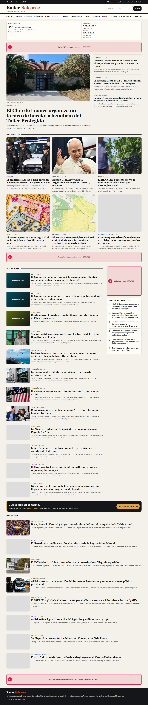
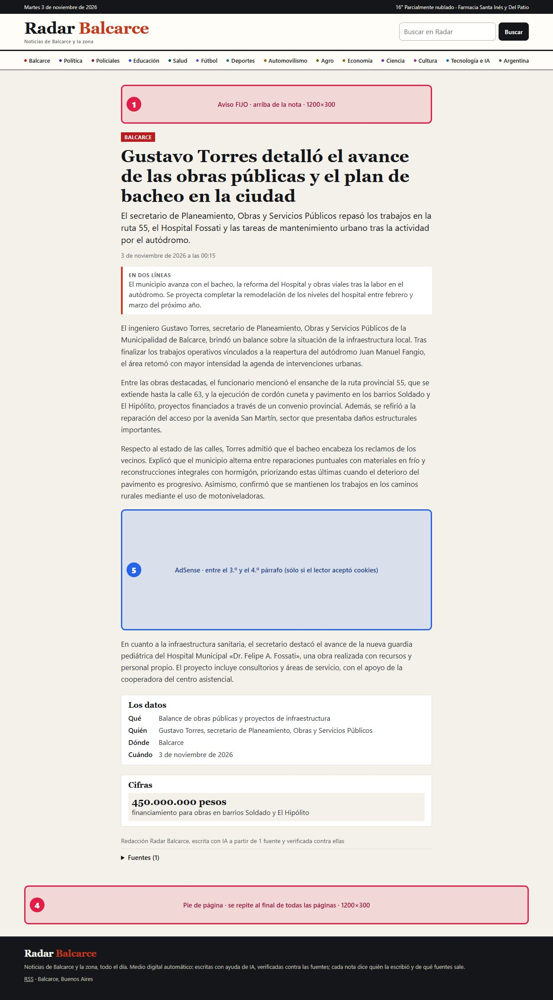
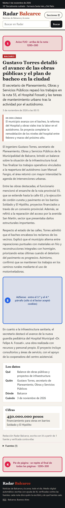
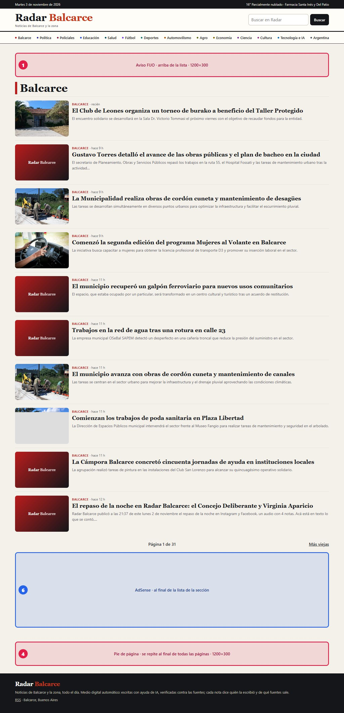
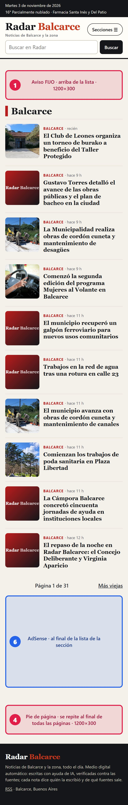

# Manual de avisos de Radar 3.0

*Para Hernán y Andrés. En palabras de persona: dónde va cada aviso, cuál rota, qué plan lo usa, qué medidas tiene que tener la imagen y cómo se carga o se saca uno. Los planes y los precios están en `PUBLICIDAD-PRIMER-COMERCIO.md` § 2; la página para el comerciante es `radarbalcarce.com/publicidad`. Las capturas son del sitio en vivo (3/11/2026) con los lugares dibujados encima: en esa fecha todavía no estaban cargados, así que los recuadros muestran dónde van a quedar.*

## 1. Los cuatro lugares propios

Todos llevan el rótulo chico **«Publicidad»** y, si el aviso tiene enlace, lo abren en una pestaña nueva. Mientras un lugar no tiene ningún aviso cargado, sale un aviso propio: «Tu comercio acá · desde $ 5.000 por mes», que lleva a `/publicidad`. Nunca queda vacío.



| N.º | Lugar | Dónde está | Rota | Plan que lo usa | Imagen recomendada |
|---|---|---|---|---|---|
| 1 | **Fijo** | Arriba de todo: en la portada (entre el clima y las noticias), en cada nota y en cada sección | **No.** Un solo comercio por mes | Sólo el de **$ 50.000** | 1200 × 300 px (proporción 4:1) |
| 2 | **Después de las postales** | Portada: entre la grilla de fotos y «Última hora» | Sí | **$ 10.000** y más | 1200 × 300 px |
| 3 | **Columna** | Portada: al costado de «Última hora» (en el celular queda entre las noticias) | Sí | **$ 20.000** y más | 600 × 500 px (proporción 6:5) |
| 4 | **Pie** | Al final de **todas** las páginas, incluida cada nota | Sí | **Todos**, desde $ 5.000 | 1200 × 300 px |

Qué incluye cada plan en el sitio (en cada plan se suman los lugares de los de abajo): **$ 5.000**, pie. **$ 10.000**, pie y después de las postales. **$ 20.000 y $ 30.000**, los tres rotativos. **$ 50.000**, el fijo más los tres rotativos.

**Cómo rota.** Cada vez que se arma una página, en cada lugar rotativo se elige un aviso al azar entre los que tienen ese lugar, y se trata de no repetir el mismo comercio dos veces en la misma página. Como las páginas se guardan unos minutos, el aviso cambia cuando la página se rearma: con avisos cargados, la portada y las secciones duran 5 minutos y las notas también (sin avisos, 1 hora). Todos los que pagan se reparten por igual. Si un lugar tiene un solo aviso, se repite antes que quedar vacío.

**La imagen.** Se achica sola al ancho de la página, así que alcanza con respetar la **proporción**: el lugar queda reservado y la página no salta al cargar. JPG o PNG, menos de 300 KB, con el texto grande (en el celular se ve a unos 360 px de ancho). Si el aviso **no tiene imagen**, se arma una caja con el nombre del comercio y su texto de una línea (hasta 120 letras): sirve para empezar rápido.

### En el celular

La misma portada se ve así (los números son los mismos):


## 2. En la nota

El fijo (1) va arriba y el pie (4) al final. Las notas no llevan los lugares 2 y 3.





## 3. Los lugares de AdSense (5 y 6)

Son **de Google**, no de un comercio: aparte de los cuatro propios, nunca mezclados ni rotando con ellos. Hoy **no existen**: se prenden cuando Hernán carga la variable `ADSENSE_CLIENTE` (ver § 6).

- **5 · En la nota**: entre el tercer y el cuarto párrafo. Sólo en notas de cuatro párrafos o más y **nunca en Policiales**.
- **6 · En las secciones**: al final de la lista de notas (menos en Policiales).
- Los dos tienen el alto reservado (280 px) para que nada se mueva, llevan el rótulo «Publicidad» y **sólo aparecen si el lector aceptó las cookies**. Si Google no tiene anuncio para mostrar, el bloque se esconde solo.
- La portada no lleva AdSense.





## 4. Cómo se carga un aviso

Lo carga Claude, con un archivo y un comando. Hernán pasa estos datos (por Telegram o por acá):

1. **Comercio** (el nombre) y, si tiene, **una línea de texto**.
2. **Enlace** (su Instagram, su página o su WhatsApp como `https://wa.me/549…`). Tiene que empezar con `https://`.
3. **Plan** (5000, 10000, 20000, 30000, 50000) o los **lugares** a mano.
4. **Desde y hasta** (el primer y el último día; los dos son opcionales).
5. **Imagen** (la subimos al sitio y se pone su dirección; si no hay, se usa sólo el texto).

Con eso se arma un archivo `aviso.json`:

```json
{
  "comercio": "Sweet Candy Bar",
  "texto": "Tortas y mesas dulces en Balcarce",
  "enlace": "https://www.instagram.com/sweetcandybar",
  "plan": "10000",
  "desde": "2026-11-10",
  "hasta": "2026-12-10"
}
```

y se corre:

```
node v3/sitio/scripts/cargar-aviso.mjs aviso.json --salida=aviso.sql
npx wrangler d1 execute radar-nucleo --remote --file=aviso.sql
```

El script revisa todo (enlace https, fechas, lugares) y avisa si algo está mal antes de tocar la base. Si no se escribe `lugares`, salen los del plan. Cargar de nuevo el mismo comercio **lo actualiza**, no lo duplica. El aviso se ve cuando la página se rearma (hasta 5 minutos).

## 5. Cómo se saca un aviso

- **Sacarlo ya:** `node v3/sitio/scripts/cargar-aviso.mjs --sacar=sweet-candy-bar --salida=sacar.sql` y después `npx wrangler d1 execute radar-nucleo --remote --file=sacar.sql`. Queda apagado en la tabla (no se borra: sirve de historial).
- **Que termine solo:** el campo `hasta`. El día siguiente ya no sale.
- Cambiar el texto, la imagen o las fechas: se vuelve a cargar con el mismo `id` (el `id` es el nombre en minúsculas con guiones, `sweet-candy-bar`).

## 6. Para prender AdSense y Google Analytics (lo hace una persona)

1. Pedir el alta en AdSense con el dominio `radarbalcarce.com` (después de que el sitio lleve un tiempo indexado; ver `INVESTIGACION-3-0-11-2026.md`).
2. Cuando lo aprueben, copiar el código de editor (`ca-pub-…`) en la variable **`ADSENSE_CLIENTE`** del Worker `radar-sitio`; y los números de bloque que dé el panel al crear una unidad para la nota y otra para las secciones, en **`ADSENSE_SLOT_NOTA`** y **`ADSENSE_SLOT_SECCION`**. Con la variable cargada aparecen solos el aviso de cookies, el script (sólo si el lector acepta), `/ads.txt` y los bloques 5 y 6.
3. Para Google Analytics, el identificador `G-…` en **`GA_ID`**. También prende el aviso de cookies.
4. Sin ninguna de las dos variables no hay aviso de cookies ni nada de Google.
