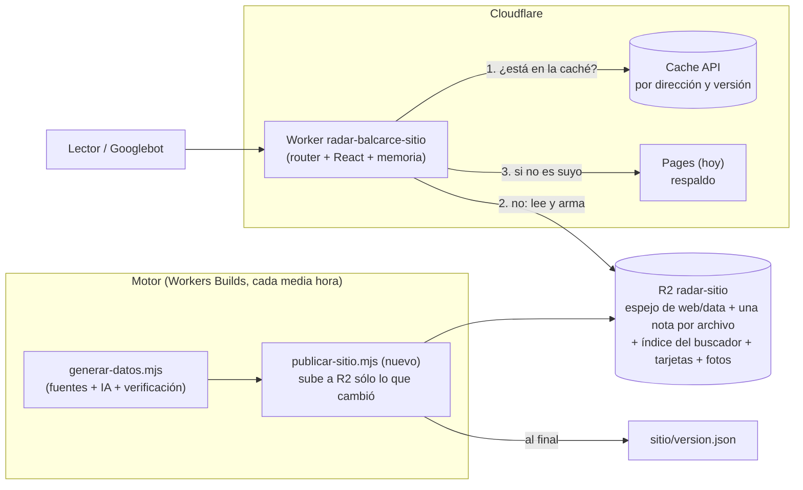

# El sitio armado por un Worker: plan de cambio de modelo

*24/10/2026. Para Hernán y Andrés (las partes en castellano simple) y para quien programe (el detalle técnico, marcado). Es un **plan con un prototipo probado en la PC**: no se desplegó nada, no se prendió nada, no se tocó el sitio actual, `reels/`, `ingesta/` ni `redes/`. Nada de esto cambia lo que se publica hoy. Se hace **después del jueves 29/10** (decisión del 24/10).*

**Cómo leer las marcas** (las mismas de `ANALISIS.md` y `COSTOS-Y-RECURSOS.md`). **[MEDIDO]** salió de una corrida real en este repositorio o en el sitio publicado, con el número a la vista. **[DOCS]** lo dicen los documentos oficiales de Cloudflare que ya leyó el proyecto (`ANALISIS.md`, 15/10; `MIGRACION-A-CLOUDFLARE.md`, 18/10). **[ESTIMADO]** es una cuenta mía con esos números. **[NO VERIFICADO]** es memoria o suposición: hay que probarlo antes de apostar a eso. Una cosa no se pudo medir en esta PC y condiciona varios números: **el motor de Workers (`workerd`) no arranca en esta máquina** (ya lo anotó la migración del 18/10), así que lo que "corre dentro de Cloudflare" (latencia real, memoria, arranque en frío) está sin medir.

---

## 0. En diez líneas

1. **Qué se propone.** Hoy el sitio se **compila entero** en cada vuelta (cada media hora): 3.863 archivos, 445 MB, 499 notas, y se sube a Cloudflare Pages. El cambio: que **un Worker de Cloudflare arme cada página cuando alguien la pide**, a partir de los datos guardados en R2, con **las mismas direcciones**, y que la vuelta del motor ya no compile nada: sólo lea fuentes, escriba con IA, guarde los datos y avise.
2. **Qué recomiendo.** La opción **(b)**: un Worker propio que usa **los mismos componentes de `web/`** con `react-dom/server`. Se pone **delante de Pages** (Pages sigue como respaldo) y toma las páginas **de a poco, empezando por las notas viejas que hoy salen de R2**. La opción (a) (OpenNext) queda como plan B si las "islas" del navegador salen más caras de lo previsto; la (c) (compilar sólo lo nuevo) queda descartada como destino (ahorra casi nada).
3. **Lo más riesgoso ya está probado.** En esta rama, el prototipo armó **las 499 notas del sitio y las 17 páginas fijas, sin `next build`, y todas salieron idénticas, letra por letra,** a las de la compilación de hoy (menos lo que Next agrega solo: sus paquetes de JavaScript). **40 ms** de CPU por nota (mediana), **28 KB** de HTML contra **71 KB** de hoy [MEDIDO, Node 24 en esta PC].
4. **No es una cuestión de minutos.** Los minutos de Workers Builds se pueden bajar con las palancas de la regla 312 (ya escritas, apagadas). Armar las páginas en un Worker ahorra **unos 3 minutos de los ~6 de cada vuelta** [ESTIMADO] y, sobre todo, **saca los topes**: 500 notas, 20.000 archivos, 2.000 redirecciones.
5. **Mejoras que trae sin pedirlas.** Las direcciones viejas de una nota (`/nota/ID`, un titular anterior) hoy dan **404** con un parche de JavaScript; pasarían a **301 de verdad**. Las notas archivadas dejan de ser HTML congelado (vuelven "Seguí leyendo", su tarjeta para compartir y su lugar en el mapa del sitio). Una nota ya no muestra el clima ni la fecha del último armado.
6. **Costo nuevo: US$ 0** hasta unos 10 millones de pedidos por mes (lo incluido en Workers Paid). Con tráfico 30 veces mayor al previsto serían unos US$ 10 por mes [ESTIMADO, § 7].
7. **SEO.** Las páginas son las mismas, con las mismas direcciones, canónicos, datos estructurados y códigos de respuesta. No se pierde nada de lo indexado (1.428 páginas hoy) si se sigue el orden de § 6: primero un sitio de prueba que se compara contra el actual 100 direcciones por vez, después tráfico parcial con vuelta atrás en un paso.
8. **Cuánto trabajo.** Unas **18 a 22 jornadas de programación asistida** repartidas en 4 a 5 semanas de calendario, con **siete etapas**, cada una con un criterio de "listo" que se mide (§ 6). Lo único nuevo para el lector es el JavaScript del navegador (buscador, menú, clima en vivo), que hay que rehacer como "islas" (§ 3).
9. **Qué ya queda hecho en la rama** (sin riesgo, ya sirve): el prototipo, el comparador de páginas, el **script que baja 100 direcciones de cada sitio y compara título, meta, canónico, JSON-LD y texto** (`scripts/medir/comparar-sitios.mjs`), la lista de direcciones, y 25 pruebas. El script ya corrió contra el sitio publicado: **100 de 100 iguales contra sí mismo**.
10. **Qué hace falta de ustedes** (§ 9): aprobar la opción, la fecha de arranque, crear un depósito R2 y una dirección de prueba, y mirar Search Console una vez por semana durante la migración.

---

## 1. Cómo es hoy y por qué duele

**En criollo.** Hoy el sitio es "un diario impreso": cada media hora el robot imprime **todas** las páginas de nuevo (aunque 450 no hayan cambiado) y las lleva al repartidor (Cloudflare Pages). Eso tiene tres costos: tarda (el armado más lento de la vuelta), se topa (no entran más de 20.000 archivos, ni más de 2.000 redirecciones, por eso el sitio guarda 500 notas y las viejas viven aparte, en R2) y congela (el clima y la fecha de cada nota son los de la última impresión).

**Lo que tiene el sitio compilado hoy** [MEDIDO: `cd web && npm run build` con los datos del 24/10, `web/out`]:

| Qué | Archivos | Peso | Comentario |
|---|---|---|---|
| Fotos (`fotos-notas/`) | 1.523 | 102 MB | Lo que más archivos suma. Ya hay un plan para sacarlas a R2 (`FOTOS-EN-R2.md`) |
| Páginas de nota (`nota/*.html`) | 499 | 34 MB | 68 KB cada una (30 `<script>` de Next, 39 KB, repiten el contenido) |
| Tarjetas para compartir (`opengraph-image`, `instagram.png`) | 448 | 270 MB | 224 notas × 2 imágenes. Dibujarlas es el 64 a 71 % de la compilación (`MINUTOS-DE-WORKERS-BUILDS.md`) |
| Buscador (`pagefind/`) | 522 | 1,7 MB | Un archivo por nota más unos 20 de índice |
| Secciones, feeds, servicios, agenda, panel, escudos, Next | ~870 | ~37 MB | |
| **Total** | **3.863** | **445 MB** | |

**Cómo se arma una vuelta** [MEDIDO en la PC; `MINUTOS-DE-WORKERS-BUILDS.md` § 2]: leer fuentes y armar datos 121 s · instalar `web/` 128 s · compilar Next 51 s (con la memoria de tarjetas) a 204 s (sin ella) · bajar `wrangler` 33 s · subir a Pages 22 s. En Workers Builds el promedio real es de **~6 minutos por vuelta** (578 minutos en 94 vueltas, Cloudflare, 24/10), y a 47 vueltas por día serían ~8.500 minutos por mes contra 6.000 incluidos.

**Cómo responde hoy a lo que no es una página en pie** [MEDIDO, `curl` al sitio publicado, 24/10]:

| Pedido | Respuesta de hoy |
|---|---|
| `/nota/titular-actual-ID` | 200, `cache-control: public, max-age=0, must-revalidate` |
| `/nota/titular-actual-ID/` (barra final) | 308 a la dirección sin barra |
| `?fbclid=…` pegado a una nota | 200 (el canónico limpia el parámetro) |
| `/nota/ID` a secas (nota posterior al 25/09) | **404** (con un JavaScript que busca la dirección buena en `/nota/indice.json`) |
| `/nota/titular-viejo-ID` | **404** (ídem) |
| `/seccion/servicios` | 301 a `/seccion/balcarce` (está en `_redirects`) |
| `/seccion/politica-99` | 404, `cache-control: no-store` |
| `/nota/sitemap-archivo.xml` | 404 (la regla 310 está escrita y apagada) |

(Lo de los dos 404 importa: el informe de Search Console del 24/10 cuenta **70 páginas "no se ha encontrado"** y **117 "rastreadas, actualmente sin indexar"**. Una redirección 301 real es lo que Google entiende; el parche de JavaScript de la página 404, no.)

---

## 2. Las tres opciones, medidas sobre este repositorio

### 2.1 Cuadro comparativo

| | **(a) OpenNext** (`@opennextjs/cloudflare`, Next dentro de un Worker) | **(b) Worker propio** (`react-dom/server` + los componentes de `web/`) — **recomendada** | **(c) Compilar sólo lo nuevo** (ISR a mano: Next sigue, pero sólo arma las notas nuevas y el resto sale de R2) |
|---|---|---|---|
| Se parece más a… | Hoy, pero sin exportar archivos | Un diario que arma la página al pedirla | Hoy, con un archivo permanente más grande |
| Páginas idénticas a las de hoy | Sí por construcción (es el mismo Next) | **Probado: 516 de 516** (499 notas + 17 páginas) | Sí por construcción |
| Tamaño del Worker | **9,75 MiB sin comprimir / 1,91 MiB comprimido** [MEDIDO, `wrangler deploy --dry-run`]; el tope pago es 10 MiB comprimido [DOCS conocidos, verificar] | **0,30 MiB / 0,09 MiB** (nota + portada + sección + layout + React, minificado) [MEDIDO con esbuild] | No hay Worker nuevo (el del archivo ya existe) |
| CPU por página sin caché (Node 24, esta PC) | **55 ms** mediana, 70 ms el 95 % (Next en modo dinámico, con el pedido HTTP) [MEDIDO] | **40 ms** mediana, 51 ms el 95 %, 95 ms el peor (sin pedido HTTP) [MEDIDO] | Cero: se sirve HTML ya hecho |
| Tamaño del HTML de una nota | 74 KB | **28,6 KB** (sin los datos de hidratación de Next) | 68 KB |
| Tiempo de la vuelta del motor | Sigue instalando y compilando Next si hay páginas prearmadas; sólo bajaría si todo es dinámico | **Sin Next, sin `npm ci` de `web/`, sin `wrangler pages deploy`**: de ~6 a ~3 min [ESTIMADO] | **38 s → 26 s** de `next build` con 20 notas en vez de 499 [MEDIDO]: ahorra 12 s de unos 360 |
| Quita el tope de 500 notas y de 20.000 archivos | Sí | Sí | Parcial: las notas viejas ya no cuentan, pero el sitio sigue siendo archivos |
| Quita el tope de 2.000 redirecciones | Sí (las resuelve el Worker) | Sí | No (siguen en `_redirects`) |
| El JavaScript del navegador (buscador, menú, clima en vivo) | Funciona sin tocarlo | **Hay que rehacerlo como "islas"** (10 archivos, 1.296 líneas) | Funciona sin tocarlo |
| Datos | Hay que reescribir la capa de datos (hoy lee archivos del disco) | Igual, pero con un truco que no toca `web/lib` (§ 4.2) | No cambia |
| Dependencia | Un adaptador que sigue a Next con retraso: pide `next >=15.5.28 <16` y hoy tenemos 15.5.27 [MEDIDO, `npm view`] | React solamente | Next |
| Qué no se midió | El arranque en frío y el costo real dentro de `workerd` (no corre en esta PC) | Ídem | — |

### 2.2 Lo que se hizo para medir cada una

- **(a) OpenNext.** Se copió `web/` a una carpeta de trabajo, se instaló `@opennextjs/cloudflare@1.20.13` + `wrangler@4.152.0` + `next@15.5.28` (**4 minutos de `npm install` en esta PC**, 335 paquetes), se sacó `output: 'export'` y se corrió `opennextjs-cloudflare build`. **Anduvo, también en Windows** (OpenNext dice que no lo soporta): **262 s** de compilación total (es el `next build` entero con las 499 notas prearmadas, más el empaquetado), 1.101 archivos / 106 MB de "cache" prearmado para subir a R2, y el Worker de arriba. Con la página de nota en modo dinámico (sin prearmar) se midió el servidor de Next en Node: **55 ms** por nota. **No se pudo correr dentro de `workerd`.**
- **(b) Prototipo propio.** Está en la rama (`infra/sitio-por-worker/`, § 8). Armó las 499 notas y 17 páginas fijas con los componentes de `web/` y se comparó contra `web/out`. El empaquetado del Worker se midió aparte con esbuild (0,30 MiB).
- **(c) ISR a mano.** Se midió lo único que (c) puede ahorrar: compilar con 20 notas en vez de 499, con la memoria de tarjetas calentada: **26 s contra 38 s**. Los ~230 s que realmente pesan en una vuelta (instalar `web/`, bajar `wrangler`, subir a Pages, y el trabajo de las fuentes y la IA) no se mueven. (c) es "lo que ya hace el archivo permanente de R2" llevado un poco más lejos; sirve como parche, no como destino.

### 2.3 Por qué (b) y cuándo cambiar a (a)

**Criterio para elegir** (en este orden): (1) que la página salga **igual** (lo que mira Google); (2) que no sume costo; (3) cuánto código nuevo hay que mantener; (4) cuánto se puede probar **antes** de exponerlo.

- (b) gana en (1) con evidencia propia (516/516), en (2) y (4) (el Worker pesa 0,3 MiB y se prueba con un script de 100 direcciones antes de tocar producción), y empata en CPU con (a). Pierde en (3): el pegamento (rutas, metadatos, islas del navegador) pasa a ser nuestro.
- (a) gana en (3): nada de ese pegamento, el buscador y el menú andan solos. Pierde en peso (32 veces más grande), en acoplamiento a la versión de Next, y en que el modo dinámico igual obliga a reescribir la capa de datos, que es la mitad del trabajo de (b).
- **Regla de corte:** se empieza por (b). Si al terminar la **Etapa 3** (las islas del navegador, § 6) llevan **más de 5 jornadas** o el HTML hidratado no se comporta igual en el celular, se **cambia a (a)** reaprovechando la capa de datos y el comparador, que son las mismas. Si al terminar la **Etapa 2** el Worker mide **más de 50 ms de CPU en la mediana dentro de Cloudflare** o falla la memoria de 128 MB, también.

---

## 3. Qué se reutiliza tal cual y qué hay que reescribir

**En criollo.** Casi todo el sitio es "recetas" (componentes que reciben datos y devuelven HTML). Esas recetas se reutilizan **sin tocarlas**. Lo que hay que escribir de nuevo es lo que hoy hace Next sin que nadie lo vea: elegir qué receta va con qué dirección, armar las etiquetas del `<head>`, y todo lo que el navegador ejecuta después de cargar la página.

| Pieza | Hoy | En el Worker | Esfuerzo |
|---|---|---|---|
| Componentes (`web/components/*`, 22 archivos), layout, páginas (`web/app/**/page.js`) | JSX | **Se reutilizan tal cual** [MEDIDO: 516 de 516 idénticas] | 0 |
| `web/lib/*` (reglas de portada, secciones, rutas, `datos-estructurados.js`, `sitemap-noticias.js`, `rss.js`, `robots.js`, `para-agentes.js`, `seguir-leyendo.js`, `cuerpo.js`, `texto.js`…) | JS puro | **Tal cual.** Son las mismas funciones (el JSON-LD y los mapas salen de las mismas) | 0 |
| `globals.css` | CSS que Next empaqueta y renombra | Se copia como archivo con nombre por contenido (`css/<hash>.css`) | 0,5 jornada |
| Metadatos (`generateMetadata`, `metadata`, `viewport`) | Los convierte Next en etiquetas | **Reescrito** y probado: `infra/sitio-por-worker/metadatos-a-etiquetas.mjs` (título con plantilla, robots, canónico, Open Graph de artículo, Twitter, íconos, imagen automática) | Hecho |
| `next/navigation` (`notFound`, `usePathname`), `next/og` | De Next | Dos piezas mínimas (`cargador/sustitutos/`) | Hecho |
| Capa de datos (`web/lib/datos.js` lee `process.cwd()/data/*.json`; `tablas.js`, `dimensiones-foto.js`, `rss-disco.js`, `escudos.js`, el `import` de `avisos.json`) | Disco | Un reemplazo de `node:fs` que lee de una memoria cargada desde R2 (§ 4.2). **`web/lib` no se modifica** | 2 jornadas |
| Rutas (qué dirección arma qué página), páginas 404, `trailingSlash`, `_headers`, `_redirects` | Next y Pages | Un router chico (50 a 100 líneas) y una tabla de cabeceras tomada de `web/public/_headers` | 2 jornadas |
| `sitemap.js`, `sitemap-index.xml`, `sitemap-news.xml`, `feed.xml`, feed por sección, `robots.txt`, `llms.txt`, `agentes/*.json`, `nota/indice.json` | Rutas de Next (`force-static`) | **Las funciones ya existen** (`xmlDeNoticias`, `xmlDeIndice`, `armarRss`, `textoDeRobots`, `armarUltimas`/`armarIndice`/`armarServicios`); sólo hay que llamarlas desde el router. **Falta** el convertidor del `sitemap.js` (devuelve objetos que Next pasa a XML, con las fotos de `<image:image>`): unas 30 líneas | 1 jornada |
| Mapa del archivo (regla 310) | Lo arma el exportador de R2 | Se reemplaza por mapas por mes `sitemap-archivo-AAAA-MM.xml` armados al pedirlos | 0,5 jornada |
| Tarjetas (`opengraph-image`, `instagram.png`) | `next/og` (satori + resvg) al compilar; dibujadas = 64 a 71 % del armado | **El motor las sigue dibujando una sola vez** (ya existe `TARJETAS_EN_R2`) y las guarda por nota en R2; el Worker las sirve con `Cache-Control` largo. Dibujarlas dentro del Worker queda como respaldo (~100 a 300 ms de CPU [NO VERIFICADO]) | 2 jornadas |
| Buscador (Pagefind) | Indexa los HTML al compilar: 522 archivos | Pagefind desde datos, sin HTML (`addCustomRecord`): **493 notas en 2,1 s, 1,2 MB, 515 archivos** [MEDIDO]; el motor sube el índice a R2 y el Worker lo sirve en `/pagefind/*`. Un archivo por nota: **no entra en archivos estáticos**, va a R2 | 1 jornada |
| JavaScript del navegador (`'use client'`: buscador, navegación, `HorasVivas`, clima en vivo, dólar, "copiar enlace", invitar; 10 archivos, 1.296 líneas) | Next lo hidrata con sus paquetes y los datos de la página | **Reescribir como "islas"**: el HTML ya sale armado igual; un paquete chico (esbuild + React) toma cada zona marcada y le da vida | 3 a 4 jornadas (la más incierta) |
| Fotos (`/fotos-notas/*`) | Archivos del sitio (1.523) | R2 con `Cache-Control` largo (el plan `FOTOS-EN-R2.md` pasa a ser obligatorio) | 1 jornada |
| Redirecciones: `_redirects` (tope 2.000), fusionadas, secciones viejas, `/nota/ID` | Pages | El Worker: busca el id en el dato de la nota y manda **301** a la dirección canónica; las fusionadas y las secciones viejas salen de tablas chicas | 1 jornada |
| Cabeceras de seguridad y de caché (`web/public/_headers`) | Pages | Una función con la misma tabla (la prueba `seo-paginas` ya cuida que no se separen del Worker del archivo) | 0,5 jornada |
| Panel del celular (`web/public/panel/`), escudos, íconos, fuentes | Archivos | **Siguen como archivos estáticos** del Worker (~200 archivos, muy por debajo de los 100.000 [DOCS]) | 0 |
| Motor (`infra/motor-cloudflare/vuelta.mjs`) | Compila Next y sube a Pages | Se le sacan esos pasos y se le agrega "publicar los datos en R2" y "armar el índice del buscador" (apagado hasta la Etapa 1) | 2 jornadas |
| Comparador y pruebas | — | **Hecho** en esta rama (§ 8) | 0 |

---

## 4. Arquitectura de datos y de caché

### 4.1 El camino de una página

1. El pedido llega al Worker. **Lo estático** (CSS con nombre por contenido, JavaScript de las islas, fuentes, escudos, íconos, panel) lo sirve Cloudflare **sin invocar el Worker** (no cuenta como pedido [NO VERIFICADO, lo documentado es "los archivos estáticos no se cobran"; confirmarlo antes de prender]).
2. El Worker mira la **caché** (Cache API). Si tiene la página de esta versión de datos, la devuelve (1 a 3 ms de CPU [ESTIMADO]).
3. Si no, **carga lo que necesita de R2** (memoria de datos compartida entre pedidos de la misma instancia, § 4.2), arma la página con los componentes (**~40 ms** de CPU [MEDIDO en Node]), la guarda en la caché y la devuelve.
4. Si la dirección no es del nuevo modelo (todavía) lo pasa a Pages (`fetch(request)` sin tocar): es **el mismo mecanismo que ya usa el Worker del archivo**.

### 4.2 Qué vive en R2 y cómo se actualiza sin compilar

El nombre del depósito es nuevo (`radar-sitio`; un depósito vacío no cuesta). La idea más importante: **no inventar un formato nuevo**.

| Objeto | Qué es | Quién lo escribe | Cuándo |
|---|---|---|---|
| `datos/portada.json`, `datos/archivo.json`, `datos/agenda.json`, `datos/futbol.json`, `datos/f1.json`, `datos/dolar.json`, `datos/avisos.json` | **Copia exacta** de los siete archivos de `web/data/` que lee hoy el sitio (§ 3 y la búsqueda en `web/lib`, `web/app`, `web/components`) | El motor, al final de `generar-datos` | Cada vuelta, **sólo si cambió** (se compara el contenido) |
| `notas/<id>.json` | Una nota (mediana 3,2 KB, la mayor 23 KB [MEDIDO]) | El motor, cuando una nota se publica o cambia | Una vez por nota (la huella evita subirla dos veces) |
| `indices/fusionadas.json`, `indices/retiradas.json` | Repetidas unidas y lápidas | El motor | Cada vuelta si cambian |
| `tarjetas/<id>/opengraph-image`, `…/instagram.png` | Las imágenes de compartir | El motor, las que ya dibuja | Cuando la nota entra en redes |
| `buscador/…` | Índice de Pagefind | El motor (Pagefind desde datos) | Cada vuelta; sólo se suben los archivos con nombre nuevo |
| `fotos-notas/<archivo>` | Fotos | Ya existe (`radar-archivo`) | — |
| `version.json` | `{ generado, huella }` | El motor, **último** | Después de todo lo demás (igual que el manifiesto del archivo y el pedido de video) |

**El truco de la capa de datos.** `web/lib/datos.js` es la pieza que sabe todo (portada, secciones, tapa, "Seguí leyendo", menú) y hoy lee `process.cwd()/data/*.json` con `node:fs`. En lugar de reescribirla, el empaquetado del Worker (esbuild) la deja **intacta** y sustituye `node:fs`/`node:path` por una memoria que el Worker llena desde R2 antes de armar la página (siete archivos, ~2,5 MB hoy [MEDIDO: `portada.json` 452 KB + `archivo.json` 1,9 MB + el resto]). Se parsean una vez por instancia y se renuevan cuando cambia `version.json`. `dimensiones-foto.js`, `rss-disco.js`, `escudos.js` y la imagen automática reciben un reemplazo pequeño que lee un `fotos-medidas.json` (que el motor ya puede escribir cuando guarda cada foto). Todo lo que no sea esos siete archivos y esas cuatro piezas ya es JavaScript puro.

**Una nota fuera del conjunto "caliente".** Las notas que no están en `archivo.json` (las que hoy sólo existen en R2 como HTML congelado y en `web/data/historico/*.json`) se piden **por id**: el Worker lee `notas/<id>.json` y la agrega a la memoria antes de armar. La **carga inicial** es única: importar `archivo.json` + `historico/*.json` (~1.500 notas hoy) como `notas/<id>.json`.

**No hace falta D1 ni KV.** El plan del 15/10 (`ANALISIS.md`, § 3) proponía D1. Con lo medido alcanza R2 más la memoria de la instancia: todas las lecturas son por clave, ninguna es una consulta. Es una pieza menos que cuidar y que pagar.

### 4.3 Caché, versión y actualización "sin purgar"

| Qué | Clave de la caché | Cuánto dura "fresco" | Y si pasó ese tiempo |
|---|---|---|---|
| Portada, secciones, `/hoy`, feeds, mapas | dirección + `version` | hasta que cambie la versión (cada media hora) | La versión nueva es otra clave: **no hay nada que purgar** |
| Nota | dirección + huella de la nota | 10 min (reciente) / 1 día (más de 2 días) | Sirve la vieja y la rearma en segundo plano (**stale-while-revalidate manual**: la respuesta lleva su hora de armado; si es vieja, `ctx.waitUntil(rearmar)`) |
| Servicios que cambian en el día (clima, farmacia, dólar) | dirección + `version` | igual que listas | Igual |
| Tarjetas y fotos | dirección | 1 año / 1 semana (hoy `max-age=604800`) | Nunca cambian con el mismo nombre (regla 136) |
| Lápida de una nota retirada | — (no se guarda en la caché) | — | **Se mira siempre**, antes de la caché: es un conjunto en memoria. Una nota retirada deja de verse en el **próximo pedido**, no en la próxima media hora (hoy tarda hasta una vuelta) |

- **Purga selectiva al publicar:** la cubre la versión en la clave. Sólo se purga a mano la excepción urgente (un menor o una víctima): la lápida alcanza para esa nota; la portada y las secciones se rearman en la vuelta siguiente, igual que hoy. *Si se quisiera purga global por dirección: la purga por URL está disponible en todos los planes pero no se verificó que alcance a las entradas de la Cache API [NO VERIFICADO]; por eso no se depende de ella.*
- **Encabezados para Google:** `ETag` con la huella de la nota y `Last-Modified` con la fecha de la nota, y respuesta **304 sin armar nada** si el pedido trae `If-None-Match`. Googlebot repite pedidos condicionales: son la mayor parte del tráfico de bots y salen casi gratis.

### 4.4 CPU, latencia y el tráfico de los bots

| Qué | Dato | Marca |
|---|---|---|
| CPU para armar una nota | **40 ms** mediana, 51 ms el 95 %, 95 ms el peor (499 notas) | [MEDIDO, Node 24, Windows] |
| Portada, secciones y /hoy | La portada 225 ms la primera vez (compila módulos); /hoy y las secciones, unos 13 ms | [MEDIDO] |
| Memoria | El proceso de Node usó 353 MB RSS / 132 MB de heap **incluyendo** React, las 499 notas armadas una tras otra y los datos | [MEDIDO]. El Worker tiene **128 MB**: hay que medir dentro de `workerd` antes de la Etapa 5 [DOCS]. El conjunto de datos caliente es de 2,5 MB |
| CPU por pedido con caché | 1 a 3 ms | [ESTIMADO] |
| Latencia con caché (desde Argentina) | Igual que hoy con Pages | [NO VERIFICADO] |
| Latencia sin caché | 40 ms de CPU + 1 a 3 lecturas de R2 (decenas de ms cada una) ≈ 100 a 250 ms | [ESTIMADO] |
| Límite de CPU de un pedido | 30 s por defecto, hasta 5 min | [DOCS] |

**"Casi todas las visitas son bots."** Los pedidos de bots son, en su mayoría, repetidos y de páginas viejas. Cómo se evita que gasten el presupuesto:

1. **Los archivos estáticos no invocan el Worker.** Sólo el HTML pasa por él.
2. **Respuesta condicional (304)** sin armar nada (§ 4.3).
3. **Caché larga en lo viejo** (una nota de hace más de 2 días: 1 día fresca + semana de tolerancia).
4. **Un presupuesto a la vista:** el vigilante ya lee las estadísticas de Cloudflare; se le suma "pedidos al Worker por día" con aviso a 150.000 por día (la mitad de lo que dan 10 millones al mes) y una **alerta de gasto** en Cloudflare (hoy no hay ninguna: `O-SEARCH-CONSOLE-24-10.md`).
5. **Reglas de Cloudflare gratuitas** para los bots malos (Bot Fight Mode y hasta 5 reglas propias): se deciden cuando se vea el tráfico real; no se cambia `robots.txt` (la política de IA es de Hernán, `AUDITORIA-SEO-LLM.md`).

---

## 5. SEO: cómo se mantiene todo y cómo no se pierde lo indexado

**Principio:** el Worker tiene que devolver **lo mismo** que devuelve hoy el sitio, salvo las cosas que se decide mejorar (marcadas "mejora").

| Qué | Hoy | En el nuevo modelo | Cómo se comprueba |
|---|---|---|---|
| Direcciones | `/nota/titular-ID`, `/seccion/x`, `/seccion/x-2`, `/hoy`… | **Idénticas.** La dirección de una nota se fija al salir (`slug`) y no se recalcula | Lista de 100 direcciones, § 6 |
| Canónico, título, descripción, robots, Open Graph, Twitter | Los pone Next | `metadatos-a-etiquetas.mjs` | **Igualdad letra por letra** en las 499 notas y 17 páginas [MEDIDO]; ficha de SEO (`fichaDe`) igual |
| JSON-LD (`NewsMediaOrganization`, `WebSite`, `NewsArticle`, `BreadcrumbList`, `CollectionPage`) | Componentes `ficha.js` | Los mismos | Idéntico [MEDIDO] |
| Fechas | `datePublished`, `dateModified`, `article:*_time` de la nota | Las mismas funciones | Idéntico |
| `noindex` de lo débil (`noSeOfreceAGoogle`) | Meta `robots` | La misma función | Idéntico |
| Sitemap de noticias (48 h), sitemap general, índice | Rutas `force-static` | Mismas funciones, armadas al pedirlas | Comparación de conjuntos de direcciones |
| Sitemap del archivo (regla 310) | Archivo de R2, apagado | **Mapas por mes** (`/sitemap-archivo-2026-09.xml`…) con límite de 50.000, listados en el índice. El actual `/nota/sitemap-archivo.xml` queda como alias hasta retirarlo | Conteo de direcciones = notas con página |
| Direcciones viejas (`/nota/ID`, titular anterior, fusionadas, `/seccion/servicios`) | 404 con parche de JavaScript / 301 sólo si están en `_redirects` | **301 siempre** (**mejora**) | Casos borde de la lista: en la comparación aparecen como "diferencias esperadas" |
| 404 | Real (404 con página) | Real | Estado |
| Notas retiradas | La página no existe | 404 (igual); **410** es una mejora opcional que Google procesa más rápido; se decide con Hernán | — |
| Barra final | 308 | 308 | Estado |
| Encabezados de seguridad | `_headers` | La misma tabla | Prueba `seo-paginas` |
| `X-Robots-Tag` de `/agentes/*` y `/panel/*`, `Content-Type` de feeds y tarjetas | `_headers` | Igual | Comparador (campo `x-robots-tag`, `content-type`) |
| Tamaño de la página | 68 KB (14 KB con Brotli) | 28,6 KB (más liviana: **mejora** para Core Web Vitals) | — |
| Notas viejas (R2): "Seguí leyendo", tarjeta propia, lugar en el mapa | No tienen (`D-SEO.md`, § 2.5) | Las tienen (**mejora**) | — |

**Lo indexado (1.428 páginas, 602 sin indexar; `O-SEARCH-CONSOLE-24-10.md`) no se toca:** no cambia ninguna dirección, ni el canónico, ni los datos estructurados. Las únicas direcciones que cambian de comportamiento son las 404 que se vuelven 301 (Google las trata mejor). Medidas para que no se pierda nada:

1. **El sitio de prueba nunca es indexable:** lleva `X-Robots-Tag: noindex` y su canónico apunta a `radarbalcarce.com` (`SITIO=https://radarbalcarce.com`). Aunque alguien lo comparta, no compite.
2. **Pasar por Pages primero:** el Worker nuevo se pone **delante** de Pages con un porcentaje (§ 6). Si algo falla o Google ve un 5xx, vuelve a Pages.
3. **Foto del "antes":** el día 29/10 se baja la lista de 100 direcciones con sus fichas de SEO y se guardan (comparador con `--salida`), más el informe de Search Console (páginas indexadas, las 404, las "rastreadas sin indexar"). Es la vara para medir después.
4. **Durante la migración se mira Search Console una vez por semana** (Estadísticas de rastreo: errores de servidor y tiempo de respuesta; Páginas: indexadas y 404; Rendimiento: impresiones). Umbrales de corte en § 6.
5. **IndexNow** y el sitemap de noticias siguen igual: se avisa cuando una nota sale.

---

## 6. Plan de migración por etapas

**Reglas del plan:** cada etapa es reversible; lo viejo sigue andando y se apaga recién cuando lo nuevo lleva 4 semanas sin fallar; **nada empieza antes del jueves 29/10**; ninguna etapa pide pagar nada.

### 6.1 Etapas, con su "listo" medible

| Etapa | Qué se hace | Está "lista" cuando… | Vuelta atrás |
|---|---|---|---|
| **0. Preparación** (ya, sin riesgo; hecha en esta rama salvo la foto del antes) | Prototipo, comparador, script de 100 direcciones, pruebas. **Falta:** la foto del antes (29/10), crear el depósito y la dirección de prueba | Hay un archivo con las fichas de las 100 direcciones de hoy; el script corre con 100/100 iguales contra sí mismo [hecho] | Borrar los archivos |
| **1. Los datos en R2** (D1 a D4) | `publicar-sitio.mjs` en el motor, **apagado** por una variable (`SITIO_DATOS_EN_R2`); importar el archivo y el histórico (~1.500 notas) | Tres días de vueltas seguidas en que R2 es idéntico a `web/data` (comparación de contenido); el paso suma **menos de 15 s** a la vuelta; ~100 escrituras por vuelta de 1 millón/mes incluidos | Apagar la variable |
| **2. El Worker en `workers.dev`** (D3 a D10) | `radar-balcarce-sitio`: notas, portada, secciones, `/hoy`, servicios, estáticos; sin tocar producción | `comparar-con-out` da **100 %** de las 499 notas y 17 páginas **leyendo de R2 dentro de Cloudflare**; en la mediana **CPU ≤ 50 ms** y **memoria < 100 MB**; `comparar-sitios` contra producción: 0 diferencias de ficha de SEO en 100 direcciones (salvo las "esperadas") | Borrar el Worker |
| **3. Las islas del navegador** (D8 a D14) | Buscador, menú, `HorasVivas`, clima y dólar en vivo, copiar y escribirnos, como paquete chico | Los 8 comportamientos probados a mano en celular y computadora (lista de verificación); paquete **≤ 120 KB** comprimido; **sin errores en consola**; sin salto de diseño al tomar la página | Quedarse en HTML sin islas (sirve) y decidir (a) o seguir |
| **4. El resto** (D12 a D18) | Mapas, feeds, `robots.txt`, `llms.txt`, `agentes/*.json`, tarjetas, buscador (Pagefind desde datos), redirecciones, 404, cabeceras | `comparar-sitios` con las 100 direcciones **incluidos los casos borde**: 100/100 iguales o "esperadas"; Pagefind responde en el celular | Igual que la etapa 2 |
| **5. Tráfico parcial** (D15 a D25) | El Worker **delante de Pages** en `radarbalcarce.com`. Orden: (i) notas con más de 30 días y fuera del sitio compilado, 100 % (hoy las atiende el Worker del archivo); (ii) 5 % de las notas recientes por hash de dirección; (iii) 25 %; (iv) 50 %; (v) 100 %; (vi) secciones; (vii) portada y servicios. **48 horas por paso** | En cada paso: **errores 5xx < 0,1 %**; mediana de tiempo de respuesta **≤ la de Pages**; Search Console: **404 y 5xx no suben**, **páginas indexadas no bajan más de 2 %**, **impresiones dentro de ±15 %** de la semana anterior | La variable `PORCENTAJE_NUEVO=0` (un cambio en el panel de Cloudflare, sin subir código) o sacar la ruta |
| **6. El corte** (D26 a D30) | El motor deja de compilar Next (`MOTOR_SIN_NEXT=Si`); Pages queda **4 semanas** con la última versión como respaldo | Dos semanas completas sin avisos del vigilante; minutos de Workers Builds del mes **< 5.000**; todas las notas siguen abriendo | Volver a prender el paso de compilar (está escrito) y poner `PORCENTAJE_NUEVO=0` |
| **7. La limpieza** (+4 semanas) | Se retira Pages, `_redirects`, `contar-archivos`, el tope de notas, el Worker del archivo y el exportador de HTML; se actualizan `CLAUDE.md`, `docs/` y las reglas | Una semana más sin problemas | Es el punto sin retorno barato: por eso se espera |

### 6.2 El día 1 (viernes 30/10) y lo que se puede preparar ya

- **Hoy y mañana, sin riesgo** (ya está en la rama): el prototipo, el comparador, `scripts/medir/comparar-sitios.mjs` y la lista de direcciones (`--lista`). Se puede **correr en cualquier momento contra producción** (sólo hace pedidos GET, de a uno, con pausa de 300 ms): `node scripts/medir/comparar-sitios.mjs --lista --n=100 > urls.txt`.
- **El jueves 29/10 a la noche** (cuando ya no haya cambios de sitio, 5 minutos): `node scripts/medir/comparar-sitios.mjs --a=https://radarbalcarce.com --b=https://radarbalcarce.com --lista-de=urls.txt --salida=base-29-10.json` y exportar de Search Console **Indexación → Páginas** y **Rendimiento**. Es "la foto del antes".
- **Día 1 (30/10):** crear el depósito R2 `radar-sitio` y la dirección de prueba (o usar `workers.dev`), y empezar la Etapa 1. **No hay nada en producción que cambie.**
- **Calendario:** Etapas 1 a 4 en paralelo parcial: la semana del 30/10 al 6/11 deja los datos en R2 y el Worker en `workers.dev`; el 13/11 las islas; la semana del 16/11 empieza el tráfico parcial; fin de noviembre el corte. **Si algo muerde, se corre la fecha: no hay apuro de costo** (§ 7).

### 6.3 Esfuerzo (jornadas de programación asistida) [ESTIMADO]

Datos 3 · Worker (router, cabeceras, redirecciones, caché) 4 · resto de rutas (mapas, feeds, robots, llms, agentes) 2 · tarjetas 2 · buscador 1 · fotos 1 · islas 3 a 4 · motor 2 · pruebas, comparador y puesta a punto 2 · documentación 1 = **21 a 22**; sin imprevistos serían 18.

---

## 7. Ahorro, costo total, riesgos y cuándo NO conviene

### 7.1 Minutos de Workers Builds

| | Hoy | Con el Worker |
|---|---|---|
| Qué hace cada vuelta | leer fuentes y armar datos (121 s) + instalar `web/` (128 s) + compilar Next (51 a 204 s) + bajar `wrangler` (33 s) + subir a Pages (22 s) + archivo (8 s) | leer fuentes y armar datos (121 s) + instalar la raíz (24 s) + subir datos a R2 (~10 s) + índice del buscador (~3 s) |
| Duración medida / estimada | **~6 min** [MEDIDO en Cloudflare, promedio] | **~2,5 a 3,5 min** [ESTIMADO] |
| Minutos por mes a 47 vueltas por día | **~8.500** (24/10) | **~3.500 a 5.000** |
| Excedente sobre los 6.000 incluidos | ~2.500 (US$ 12 a 15) | **0** |
| Cambios de código del Worker | — | Se despliegan por separado (hoy el workflow «Desplegar Workers de Cloudflare»): ~1 minuto cada uno, unos 10 por día de trabajo → < 300 min/mes |

(Las palancas de la regla 312 —`TARJETAS_EN_R2` y la noche por hora— también llevan el mes a entrar en 6.000. **El Worker no es necesario para eso**; por eso este cambio es una decisión de estructura, no de plata.)

### 7.2 Costo total

| Concepto | Hoy | Con el Worker |
|---|---|---|
| Workers Paid | US$ 5 | US$ 5 |
| Pedidos al Worker (10 M/mes incluidos; US$ 0,30 por millón de más [NO VERIFICADO, confirmar en la página de precios]) | — | 0 hasta 10 M |
| CPU (30 M ms/mes incluidos; US$ 0,02 por millón de ms de más [NO VERIFICADO]) | — | 0 hasta 30 M ms |
| R2 (10 GB, 1 M escrituras, 10 M lecturas incluidas; la salida no cuesta) | ~223 MB de notas | + ~40 MB por año de notas + índice del buscador (~5 MB) → **0** |
| Minutos de armado | 0 si entran en 6.000 | 0 |
| **Nuevo** | | **US$ 0** |

Escenarios de tráfico al Worker (90 % de aciertos de caché, 45 ms por armado, 3 ms por acierto) [ESTIMADO]:

| Pedidos al mes | CPU total | Excedente de pedidos | Excedente de CPU | Extra por mes |
|---|---|---|---|---|
| 0,5 M | 3,6 M ms | 0 | 0 | **US$ 0** |
| 10 M | 72 M ms | 0 | 42 M ms | **~US$ 0,84** |
| 30 M | 216 M ms | 20 M | 186 M ms | **~US$ 10** |

Hoy el sitio tiene "entre 6 y 11 lectores reales por día" (el resto, bots; `COSTOS-Y-RECURSOS.md`) y 7.720 pedidos en todos los Workers del mes: estamos **a dos órdenes de magnitud** de cualquier cobro.

### 7.3 Riesgos

| Riesgo | Qué tan probable / grave | Qué se hace |
|---|---|---|
| **Las islas del navegador salen distintas** (menú, buscador, clima) | Media / media. Es lo único que Next hacía solo | Etapa 3 con lista de verificación; si pasa de 5 jornadas, cambiar a (a). Mientras tanto la página funciona sin JavaScript |
| **El Worker pasa los 128 MB o los 50 ms en `workerd`** | Baja-media / alta: es lo que no se midió | Etapa 2 lo mide **antes** de exponer nada; el conjunto de datos caliente es de 2,5 MB; si hace falta, se reduce el conjunto o se arma en el motor y se guarda el HTML (sigue siendo (b) con el motor como armador) |
| **Googlebot ve algo distinto** | Baja / alta | Igualdad letra por letra, comparador de 100 direcciones, noindex en la prueba, tráfico por hash de dirección, umbrales de Search Console, vuelta atrás en un paso |
| **Los bots consumen pedidos** | Baja / baja (cobro) | 304 sin armar, caché larga, alerta de gasto, regla de Cloudflare |
| **Una nota retirada sigue visible** (menor o víctima) | Baja / **la más grave del proyecto** | Lápida revisada **antes** de la caché en cada pedido; prueba nueva por nota retirada; la regla "nunca identificar a un menor ni a una víctima" no cambia |
| **Un cambio de código rompe todas las páginas a la vez** | Media / alta | Hoy ya pasó con las pruebas (`ANALISIS.md`, § 1.3). Se mitiga con el comparador en cada despliegue (las mismas 100 direcciones) y la vuelta atrás del Worker |
| **Dependencia de nuestro propio pegamento** (router, metadatos) | Media / media | ~150 líneas, con pruebas; el esquema de metadatos se prueba contra `web/out` mientras exista |
| **React 19 vs. lo que dice `package.json`** | Baja / baja | El sitio ya renderiza con el React 19 que trae Next adentro (el `"react": "^18"` de `web/package.json` no se usa en el App Router); el Worker usa el mismo [MEDIDO: `19.2.0-canary`] |

### 7.4 Qué haría que NO convenga (y entonces se queda como está)

1. Que dentro de `workerd` el armado de una nota pase de **~80 ms** de CPU en la mediana, o la memoria de **~100 MB**.
2. Que las islas lleven **más de 5 jornadas** y la opción (a) tampoco cierre (por ejemplo, el adaptador no sigue a la próxima versión de Next).
3. Que Search Console muestre, durante el tráfico parcial, **caídas sostenidas** de páginas indexadas (> 2 %) o de impresiones (> 15 %) que no se expliquen por el calendario.
4. Que el tráfico real (con bots) prometa **más de 30 millones de pedidos por mes** y Cloudflare no acepte reglas para frenarlos.
5. Que las palancas de la regla 312 alcancen y el **tope de 500 notas deje de molestar**: el cambio sigue siendo mejor (las notas viejas con su "Seguí leyendo", direcciones viejas en 301), pero **deja de ser urgente**. Es una decisión de producto, no de plata.
6. Que no haya quién mire Search Console una vez por semana durante cuatro semanas.

---

## 8. Lo que queda en la rama (prototipo y herramientas)

**Qué hay** (todo nuevo, nada existente se modificó):

| Archivo | Qué es |
|---|---|
| `infra/sitio-por-worker/render-nota.mjs` | Arma la página de una nota (`renderizarNota`: 200 / 301 / 404) y cualquier otra página de `web/app` (`renderizarPagina`) con los componentes de `web/` |
| `infra/sitio-por-worker/metadatos-a-etiquetas.mjs` | Lo que Next hace con `metadata` / `generateMetadata`: título, robots, canónico, Open Graph, Twitter, íconos |
| `infra/sitio-por-worker/cargador/` | Cargador de Node: alias `@/`, JSX, React 19 de Next, `next/navigation`, `.css`, `.json`. **Sólo para el prototipo y las pruebas** (en el Worker lo hace esbuild) |
| `infra/sitio-por-worker/comparar-html.mjs` | Normaliza HTML (saca lo de Next), diferencias línea por línea, ficha de SEO (`fichaDe`) y su comparación |
| `infra/sitio-por-worker/comparar-con-out.mjs` | Arma notas y las compara con `web/out`: `node infra/sitio-por-worker/comparar-con-out.mjs --n=60 --ver=1` |
| `infra/sitio-por-worker/comparar-sitios.mjs` + `scripts/medir/comparar-sitios.mjs` | Compara **dos sitios publicados** dirección por dirección (estado, redirección, ficha de SEO, conjunto de los mapas). `--lista` arma la lista de 100 |
| `pruebas/sitio-por-worker.test.mjs`, `pruebas/comparar-sitios.test.mjs` | 25 pruebas. Las que necesitan `web/node_modules` o `web/out` se saltean solas si no están (la suite completa borra `web/out` antes de correr) |

**Cómo se corre la comparación** (con `web/out` recién compilado, `SITIO=https://radarbalcarce.com`):
`cd web && npm run build` · `node --test pruebas/sitio-por-worker.test.mjs` · `node infra/sitio-por-worker/comparar-con-out.mjs --n=600`

**Resultado** [MEDIDO 24/10, datos del 24/10 10:30]:

| Qué | Resultado |
|---|---|
| Notas | **499 de 499 idénticas** |
| Páginas fijas y dinámicas (`/`, `/hoy`, `/seccion/balcarce`, `/seccion/politica-2`, `/farmacias`, `/agenda`, `/clima`, `/dolar`, `/util`, `/quienes-somos`, `/contacto`, `/politica-de-privacidad`, `/tablas`, `/tablas/liga-profesional`, `/tablas/formula-1`, `/compartir`, `/tema/concejo`) | **17 de 17 idénticas** |
| Ficha de SEO (título, descripción, canónico, robots, metas, JSON-LD, h1/h2, enlaces, imágenes, texto) | Sin diferencias en las 499 |
| Comparador contra producción (100 direcciones, incluidos los casos borde, contra sí misma) | 100 de 100 iguales |

**Lista de diferencias** (todo lo demás es igual, letra por letra; el orden de los atributos de cada etiqueta no cuenta):

| # | Diferencia | Por qué | Qué hay que hacer |
|---|---|---|---|
| 1 | Next agrega **30 `<script>` por página (39 KB)**: los paquetes de JavaScript y la copia del contenido para hidratarlo | Es de Next | Las islas (Etapa 3) reemplazan el JavaScript; el contenido no se repite (por eso 28,6 KB contra 71,5 KB) |
| 2 | Un comentario con el código del armado (`<!--q6fddMFs…-->`) tras el `<!DOCTYPE>` | Es de Next | Nada |
| 3 | El nombre de la hoja de estilos (`/_next/static/css/<hash>.css`) | Next lo cambia en cada armado | El Worker usa su propio nombre por contenido |
| 4 | Un `
` con dos comentarios al abrir el `<body>` | Marca de Next para sus zonas en espera | Nada |
| 5 | `<link rel="preload" as="script">` hacia los paquetes de Next | Es de Next | Nada |
| 6 | "hace 12 h" cambia con la hora en que se arma | En el sitio de hoy se congela al compilar; en el Worker es la hora del pedido | **Mejora.** En la comparación se fija el reloj en la hora del armado |
| 7 | La imagen de compartir de páginas con `opengraph-image` (`/hoy`, secciones, `/tema/…`) lleva `?<huella de 16 letras>` | La huella es la del PNG que dibuja Next | El Worker usa la huella de su propia tarjeta (se pasa como parámetro en el prototipo) |
| 8 | **No cubierto todavía:** `/agenda/<evento>`, tarjetas dibujadas, feeds, mapas, `robots.txt`, `llms.txt` | Faltan las rutas; las funciones ya existen | Etapa 4 |

**Límites del prototipo:** lee los datos del disco (en el Worker, de R2); usa el compilador de Next para el JSX (en el Worker, esbuild); no tiene JavaScript del navegador; corre en Node, no en `workerd`. Se pone `process.chdir(web)` al cargarlo (no se importa desde ningún otro lado).

---

## 9. Qué necesito de ustedes

1. **Aprobar la recomendación (b) y la regla de corte a (a)** (§ 2.3), o decir que prefieren (a) desde el principio.
2. **La fecha de arranque:** el viernes 30/10 como día 1, o más adelante. El 29/10 a la noche, 5 minutos: correr el comando de la foto del antes y exportar dos pantallas de Search Console (puedo dar los pasos uno por vez).
3. **Crear en Cloudflare (`radarbalcarce@gmail.com`) —lo pega una persona, nunca en un chat—:** el depósito R2 `radar-sitio`; las claves de R2 para el motor (las que ya existen para `radar-motor` pueden servir); la dirección de prueba (`nuevo.radarbalcarce.com`, con su registro DNS, **o** la de `workers.dev`, que no pide DNS). Preferiría `workers.dev` para empezar.
4. **Una alerta de gasto en Cloudflare** (Billing → Budget Alert). Hoy no hay ninguna.
5. **Mirar Search Console una vez por semana** durante las etapas 5 y 6 y mandar el resumen de "Páginas" y "Rendimiento" (puedo armar una plantilla de tres renglones).
6. **Decisiones de producto, sin apuro:** ¿las notas retiradas pasan de 404 a **410**? ¿Las notas de más de 12 meses siguen indexables? ¿El mapa del archivo se mantiene por mes? (Mi propuesta: 301 en las direcciones viejas, 404 en las retiradas, todo indexable.)
7. **Que nadie apague** `web/data/historico/` ni borre `banco-fotos.json`: la carga inicial de las notas viejas sale de ahí.

---

## 10. Lo que no pude comprobar

- **Todo lo que corre dentro de `workerd`:** CPU real, memoria de 128 MB, arranque en frío, latencia, tamaño de lo que carga (no arranca en esta PC; la verificación es la Etapa 2).
- **Que los archivos estáticos de un Worker no cuenten como pedido** y el límite exacto de archivos (100.000, 25 MiB cada uno) [DOCS del 15/10]; precios de pedidos y de CPU de más; que la purga por URL alcance a la Cache API.
- **Que el JSX de `web/` entre en esbuild con `loader .js = jsx` y alias `@/`** en el Worker de verdad (sí entró en la medición del tamaño, 0,30 MiB, y el prototipo usa el equivalente en SWC).
- **El comportamiento de las islas** (la Etapa 3 existe para eso) y de `hydrateRoot` sobre el HTML de otro servidor.
- **Cuánto tráfico real hay**, bots incluidos: no hay un contador de pedidos HTTP en el repositorio (las estadísticas son de visitas con JavaScript).
- **Los minutos reales de la vuelta sin Next en Workers Builds:** § 7.1 es una resta sobre las mediciones de la PC; el registro por paso de la regla 312 va a dar el número cuando se mida una vuelta de prueba (Etapa 1).
- **OpenNext dentro de `workerd`** y su arranque en frío con un archivo de 5,4 MB.
